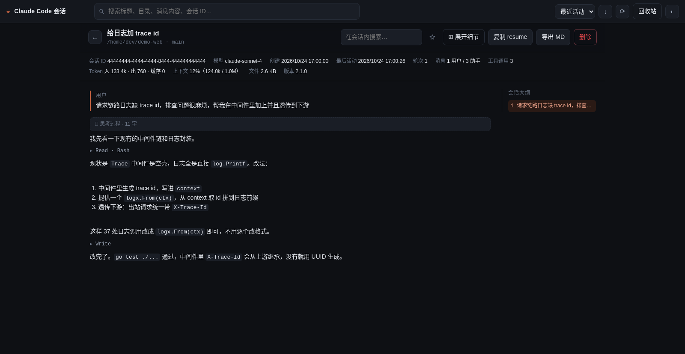
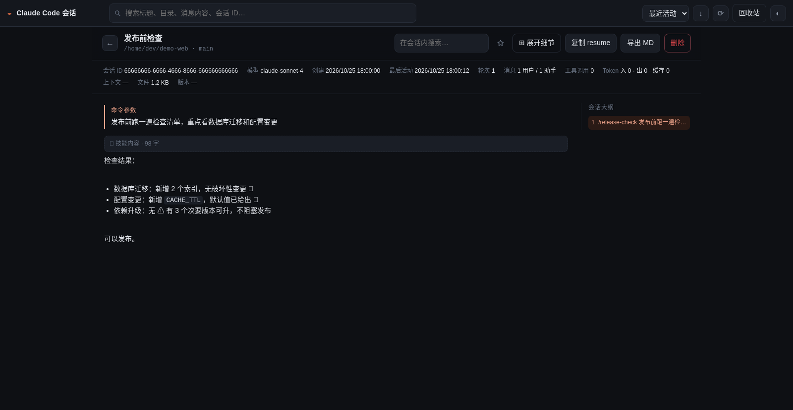
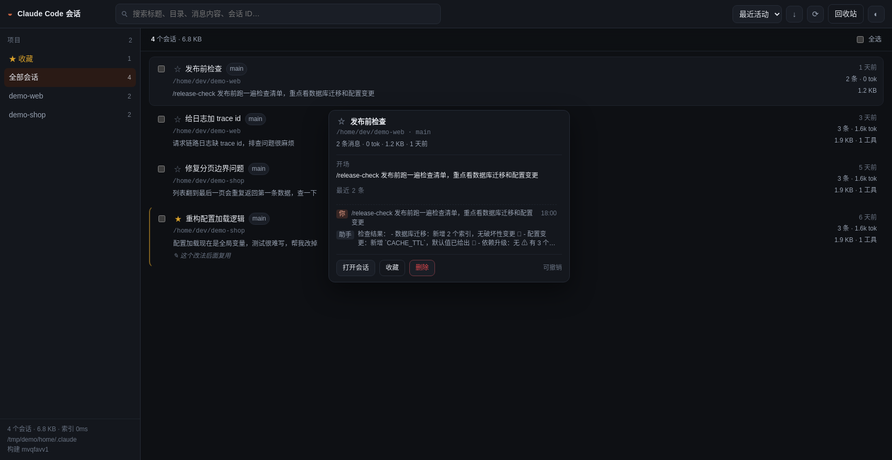
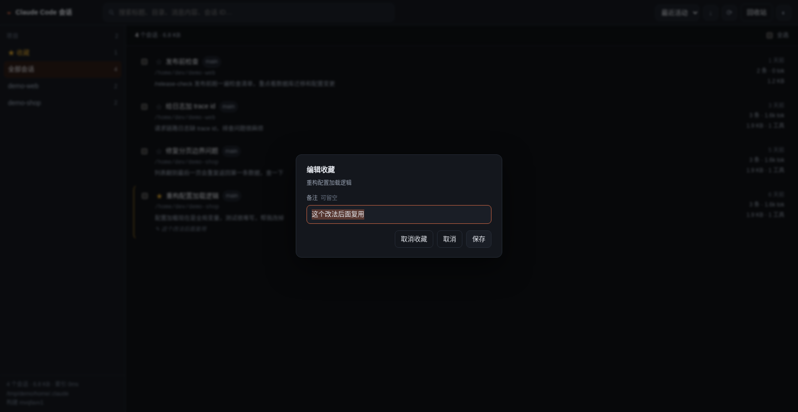
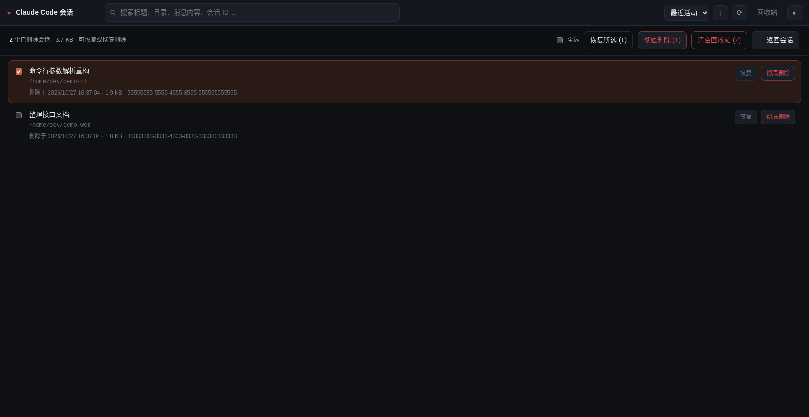

# claude-sessions

浏览、搜索、删除 Claude Code 本地会话的网页工具。单文件二进制，无运行时依赖。

启动后是一个本地网页，只做三件事：**看、搜、删**。







> 以上截图使用**合成数据**（`demo-shop` / `demo-web` 等示例会话）生成，不含任何真实会话内容。


```bash
go build -trimpath -ldflags "-s -w" -o claude-sessions .
./start.sh                     # 等价于 ./claude-sessions web，打开 http://127.0.0.1:9999
```

开机自启（systemd 可用的 WSL）：把 `ExecStart` 指向二进制即可

```ini
# /etc/systemd/system/claude-sessions.service
[Unit]
Description=claude-sessions web
After=network.target

[Service]
ExecStart=/path/to/claude-sessions/claude-sessions web --no-open
Restart=on-failure
WorkingDirectory=/path/to/claude-sessions

[Install]
WantedBy=multi-user.target
```

```bash
systemctl daemon-reload && systemctl enable --now claude-sessions
```

## 为什么不套 Node / SQLite

在几百 MB、上百个会话的真实数据上验证过，这两样都不需要：

| 观察项 | 量级 | 影响 |
|---|---|---|
| 会话文件 | 上百个 jsonl，十几个项目目录 | 规模小，内存索引足够 |
| 总体积 | 数百 MB，最大单文件上百 MB | 不能整文件读进内存，必须流式逐行 |
| 其中真正的对话正文 | 约 **5%~10%** | 其余是 hook 输出、`api-request-blob` 等噪音，**跳过不解析** |
| 全量建索引 | **秒级** | 启动扫一遍即可，不需要持久化数据库 |
| 单行最大值 | 1~2 MB | 用 `bufio.Scanner` + 8/64 MB 上限就够，不需要自写行读取器 |

所以：**Go 标准库 + 内存索引 + `go:embed` 前端**。`go build` 出一个 ~5 MB 的二进制，拷到任何机器直接跑，不用装 node、不用编译 SQLite 扩展、不用起 bundler。

前端是手写的单页（`assets/` 三个文件，无 npm 依赖），改完 `go build` 即可，`go:embed` 会打包进去。

## 用法

```bash
claude-sessions web                  # 启动网页界面（默认 127.0.0.1:9999）
claude-sessions web --port 0         # 随机端口
claude-sessions web --no-open        # 不自动开浏览器
claude-sessions web --host 0.0.0.0   # 允许从其他机器访问（无鉴权，谨慎）
claude-sessions list                 # 终端里列出所有会话
claude-sessions scan                 # 只扫描并打印统计
```

| 参数 | 默认值 | 说明 |
|---|---|---|
| `--home` | `~/.claude` | Claude Code 配置目录（也支持 `CLAUDE_CONFIG_DIR`） |
| `--state` | `~/.claude-sessions` | 本程序状态目录，回收站放在这里 |
| `--port` | `9999` | 端口被占用时自动向后找 20 个 |
| `--host` | `127.0.0.1` | 监听地址 |

## 功能

**列表**
- 标题优先用 `/rename` 设置的名字，没有才用 Claude Code 自动生成的 `ai-title`，再没有才用第一条提问
- 按项目分组（左侧栏）、按最近活动/创建时间/消息数/大小/标题排序
- 排序旁的 `↓ / ↑` 按钮一键翻转顺序（比如让最老的会话排在最前），排序键和方向都会记住
- 标题优先取会话里 Claude 写好的 `ai-title`，没有才回退到第一条真实提问
- 一行统计：创建时间 · 最后活跃 · 消息数 · token · 文件大小 · 工具调用数 · **上下文占用百分比**
- 上下文占用取最后一条 assistant 消息的输入侧 token，窗口大小从 `cost-state` 里的模型名识别（带 `[1m]` 即 1M），超过 70% 标黄、90% 标红
- 进程还活着的会话标注「运行中」（读 `~/.claude/sessions/*.json` 的 pid，并用 `/proc/<pid>/cmdline` 防 pid 复用误判）

**搜索**
- 一个框同时搜标题、目录、分支、会话 ID 和**会话全部对话正文**
- 多关键词空格分隔，AND 语义；结果带命中次数和高亮片段
- 搜索基于建索引时缓存的纯文本（体积通常在几十 MB 量级），所以是毫秒级，不需要 FTS

**悬停预览**
- 鼠标在列表行上停留 0.36 秒弹出卡片：标题、路径、统计，以及**可用滚轮翻看的最近 60 条对话**（提问带时间，按轮次分隔）
- 卡片头部的标题和底部的「打开会话 / 删除」固定不动，只有中间对话区滚动；`overscroll-behavior: contain` 保证滚到底也不会带动背后的列表
- **位置以光标为锚点**：出现在光标右下方（右边放不下就放左边），当前行和顶栏都不会被盖住，所以可以一路往下划、逐行切换预览
- 空间不够时按可用空间压缩高度，永不越过顶栏（否则会盖住搜索框）
- 收起时机：光标既不在会话行、也不在卡片上时，**480 ms 后消失**；判定用每 150 ms 一次的 `elementFromPoint` 轮询，不依赖 `pointerout` 事件配对，所以列表重渲染、卡片被重新定位都不会漏掉；移到顶栏、滚动列表、按 Esc、鼠标离开窗口时立即消失
- 移进卡片本身不会收起（否则删除按钮和滚轮都没法用）
- 换行预览需要**停留 0.6 秒**才切换，且切换前会再确认光标还停在原来那一行；光标进入卡片后立即取消待切换——从行滑向卡片按钮的路上会经过下一行，不这样做卡片会在你点删除前被换掉
- 卡片**永远不会覆盖当前行**：放在行的上方或下方（按空间大的一侧），所以行内轻微移动不会“误入”卡片
- 侧栏底部显示当前构建号；服务重新编译后，已打开的页面会在 8 秒内提示「服务已更新，刷新」
- 别处新建的会话（另一个终端、hook、甚至别的机器）会在 10 秒内以「N 个新会话 · 刷新」的按钮提示，点一下才刷新，不会在你看列表时突然重排
- 只读文件头 192 KB + 尾部 1 MB，几百 MB 的会话预览也只要 **毫秒级 / 十几 KB**（全量解析要秒级）
- 删除后弹出「撤销」，不弹确认框打断操作；彻底删除仍需去回收站二次确认

**收藏**
- 点列表行内 `☆`、悬停卡、详情页的星标按钮 → 弹窗填备注（**可留空**），确认即收藏
- 已收藏的会话再点 `★` → 「编辑收藏」，可改备注或点「取消收藏」
- **删除保护**：已收藏的会话在取消收藏之前**完全无法删除**——悬停卡的删除按钮直接禁用，一对一删除会被拦下，批量删除会跳过并提示；接口层同样拒绝，没有强制参数可绕过
- 侧栏「★ 收藏」一键只看收藏，批量选中后可「★ 收藏 / ☆ 取消收藏」


**会话阅读**
- **线性阅读流**（像 CLI 那样从上往下读）：用户提问是一个带竖线的引用块，助手正文直接铺开，不套卡片、不按轮折叠
- 只有两样东西收成一行，点开才看细节：`思考过程 · N 字`、`▸ Read · Bash ×2`（工具调用按名称聚合并计数，失败标红）
- 工具入参 JSON、工具结果正文都在展开后的块里，失败的结果整体标红
- 图片显示为 `[图片 image/png]` 占位，不加载 base64（避免大图拖慢页面）
- 顶部一个开关统一控制所有细节块：`⊞ 展开细节` / `⊟ 折叠细节`
- 右下角浮动「↑ 回到顶部 / ↓ 回到底部」，贴在大纲右侧，滚到头或尾时对应按钮自动置灰
- 复制 `cd <目录> && claude --resume <id>` 继续对话
- 导出 Markdown，或下载原始 jsonl
- 子代理（Task 工具派生的 `subagents/*.jsonl`）可切换查看
- 深链：`/#/session/<id>?turn=12`，可直接定位到某一轮

**回收站**
- 每行可勾选，支持全选/半选状态，批量「恢复所选」和「彻底删除」
- 「清空回收站」一键永久删除，确认框会给出总数量和总体积
- 单个会话仍保留行内的「恢复 / 彻底删除」按钮

**删除**
- 双保险：软删除 → `~/.claude-sessions/trash/<id>/`，随时可恢复；彻底删除才真正 `rm`
- 会话的伴生目录（`<id>/subagents/`）跟随整体移动，不会留孤儿文件
- **运行中的会话拒绝删除**（正在被 Claude Code 写入的文件移走会出问题）
- 支持多选批量删除、回收站批量恢复/清理

## 收藏数据存在哪

`~/.claude-sessions/marks.json`，以 sessionId 为键，独立于 Claude Code：

```json
{
  "version": 1,
  "marks": {
    "<sessionId>": { "starred": true, "note": "下次复用的模板", "updatedAt": "..." }
  }
}
```

为什么不是别的方案：

| 方案 | 问题 |
|---|---|
| 往会话 `.jsonl` 里追加记录 | 改 Claude Code 的数据文件；正在运行的会话同时写同一文件，有写坏风险 |
| 会话旁的 sidecar 文件 | 仍然往 `~/.claude/projects` 里塞东西，Claude Code 会扫这个目录 |
| **应用状态目录（当前做法）** | 与 Claude Code 完全隔离，它永远看不到；删掉这个文件也不影响任何会话 |
| 浏览器 localStorage | 换浏览器/清缓存就丢，服务端过滤拿不到 |

- 备注可留空，留空就只是收藏；`tags` 字段保留在文件里但界面已不使用
- 原子写入（临时文件 + rename），断电不会留下半个文件
- `claude --resume` 之后 sessionId 不变，标记继续有效
- 会话被彻底删除时，对应标记一并清理
- 备份/迁移只需拷贝 `~/.claude-sessions/`

## 索引是怎么更新的

Claude Code 只是往 `.jsonl` 里追加，所以扫描是**增量**的：

| 阶段 | 做法 |
|---|---|
| 启动 | 全量扫一遍 |
| 之后每次重扫 | 只读每个文件**新增的字节**（记住上次的 `parsedOffset`），文件变短才回退到全量 |
| 子代理转录 | 按 `subagents/` 目录的 mtime 缓存，目录没变就不重读（上百个文件、几十 MB 的情况能省下数百毫秒） |
| 触发时机 | 读取接口带 2 秒 TTL：`GET /api/sessions`、`/api/stats`、`/api/projects` 都会顺带看一眼磁盘 |

效果：数百 MB 的会话库，**一次增量重扫 2 ms**（改之前是 850 ms）。所以「刷新页面」就能看到新会话，不需要点 ⟳。

## 数据来源

只读 Claude Code 的既有文件，不修改其格式：

```
~/.claude/
├── projects/<项目目录>/<sessionId>.jsonl             会话正文（append-only）
│                      └── <sessionId>/subagents/*.jsonl   子代理会话
├── sessions/<pid>.json                               运行中的进程表
└── history.jsonl                                     输入历史（本工具未用）
```

`projects/*.jsonl` 每行一条 JSON 记录，本工具只取 `user` / `assistant` / `ai-title` 三类，其余（`attachment`、`api-request-blob`、`file-history-delta`、`mode` 等）在建索引阶段就按字节跳过。

## HTTP API

| 方法 | 路径 | 说明 |
|---|---|---|
| GET | `/api/stats` | 总览：会话数、项目数、体积、扫描耗时 |
| GET | `/api/projects` | 项目列表及计数 |
| GET | `/api/sessions?q=&project=&sort=&star=1&tag=xxx&limit=&offset=` | 列表 + 搜索 + 标记过滤 |
| GET | `/api/sessions/{id}?from=&count=&agent=` | 会话详情（分页返回轮次） |
| GET | `/api/sessions/{id}/search?q=` | 会话内搜索 |
| GET | `/api/sessions/{id}/export?agent=` | 导出 Markdown |
| GET | `/api/sessions/{id}/raw?agent=` | 下载原始 jsonl |
| POST | `/api/rescan` | 重新扫描磁盘 |
| GET | `/api/marks` | 全部收藏 |
| POST | `/api/marks` | 设置收藏：`{"ids":[...],"starred":true}` 或 `{"updates":[{"id":"...","starred":true,"note":"x"}]}` |
| POST | `/api/open` | 在系统终端里打开会话，body `{"id":"..."}`；命令由服务端拼装 |
| POST | `/api/delete` | 软删除，body `{"ids":["..."]}`；已收藏的会话会被拒绝（响应里的 `blocked` 列表），需先取消收藏 |
| GET | `/api/trash` | 回收站列表 |
| POST | `/api/trash/restore` | 恢复，body `{"ids":[...]}` |
| POST | `/api/trash/purge` | 彻底删除，body `{"ids":[...]}` |

## 代码结构

```
main.go      命令行入口、启动扫描、拉起 HTTP 服务、打开浏览器
session.go   数据结构（会话/轮次/消息/内容块）
scan.go      jsonl 流式解析：元信息提取、搜索文本、轮次构建、工具调用归纳
index.go     内存索引：列表、多关键词搜索、软删除/回收站/恢复、子代理发现
server.go    HTTP 路由、Markdown 导出、静态资源（go:embed）
proc.go      进程存活检测
assets/      前端（index.html / app.js / style.css，无构建步骤）
```

## 已知限制

- 索引全在内存，进程退出即丢弃，下次启动重新扫一遍（首次约 3 秒，主要花在子代理转录上）。
- 搜索片段取自 ASCII-lowercase 后的文本，纯英文片段显示为小写；中文不受影响。
- 超长内容按 48 KB/块截断后返回，避免打开超大会话时把浏览器打爆；原始文件请用「下载 jsonl」。
- 只识别 Claude Code 自己的 jsonl 格式，版本漂移导致新记录类型时会静默忽略（不会报错）。
- 无鉴权，默认只监听 127.0.0.1。

## 跨平台：在终端里打开会话

详情页「复制 resume」左边的图标按钮，会在系统终端里执行
`claude --resume <session-id>`，工作目录是会话当初的 cwd。三个平台分别处理：

| 平台 | 启动方式 |
|---|---|
| **Windows** | `wt.exe -d <cwd> cmd /k claude --resume <id>`；没有 Windows Terminal 时退回 `cmd /c start` 新窗口 |
| **macOS** | `osascript` 让 Terminal.app 执行 `cd <cwd> && claude --resume <id>` |
| **Linux** | 依次尝试 `$TERMINAL`、gnome-terminal、konsole、xfce4-terminal、alacritty、kitty、wezterm、foot、x-terminal-emulator、xterm |
| **WSL** | 优先 `wt.exe wsl.exe -d <发行版> -- bash -lc "cd <cwd> && claude --resume <id>"`，在 Windows Terminal 里开新标签页 |

实现要点：

- 平台代码用构建标签分开（`terminal_linux.go` / `terminal_darwin.go` / `terminal_windows.go`），
  `terminal.go` 只放公共逻辑，`GOOS=darwin/windows/linux go build` 都能通过
- **必须用 claude 的绝对路径**：WSL 里拉起的 shell 会继承 Windows 的 PATH，
  裸写 `claude` 会命中 Windows 版 `claude.exe`，它读 Windows 的 `~/.claude`，
  报「No conversation found」
- 服务里没有 `WSL_DISTRO_NAME`，用 `wslpath -w /` 的 UNC 路径反推发行版名
- systemd 服务的 PATH 不含 `/mnt/c/...`，找 `wt.exe` 时会额外扫
  `/mnt/c/Users/*/AppData/Local/Microsoft/WindowsApps/`
- 命令只接受会话 id（`^[0-9a-zA-Z-]{8,64}$`），命令由服务端拼装，不接受前端传入的任意命令
